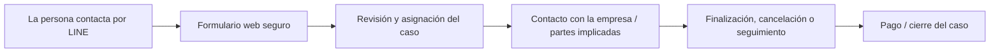

# Taishoku Reset — un SaaS de 退職代行 en producción

> **Caso de estudio, no una release de código.** Este repositorio no contiene
> código, datos de clientes, prompts, esquema de base de datos, lógica de precios
> ni métricas internas. El recorrido de código está disponible bajo NDA.

[English](README.md) · [Português](README.pt.md) · [日本語](README.ja.md) · [Arquitectura](architecture.md) · [Fuentes](SOURCES.md)

---

## De un vistazo

| | |
|---|---|
| **Producto** | SaaS de 退職代行 (servicio de salida laboral) para el mercado japonés |
| **Canal** | LINE + formularios web seguros + operación humana |
| **Estado** | En producción desde 2026-11-08 |
| **Rol** | Cofundador y Tech Lead |
| **Alcance técnico** | Arquitectura, implementación, despliegue, integraciones y fiabilidad |
| **Enlaces públicos** | [Web](https://taishokureset.com) · [Instagram](https://www.instagram.com/taishokureset/) · [特商法](https://taishokureset.com/tokushoho) |

---

## El problema

Dejar un trabajo en Japón puede ser un proceso difícil: contactar con la empresa, gestionar papeleo, atender llamadas y proteger la privacidad. Un servicio de 退職代行 se encarga de ese proceso en nombre de la persona.

El producto debe sostener una conversación sensible con poco margen de error: la persona necesita entender qué va a pasar, la empresa necesita un flujo de casos fiable y el sistema debe tratar datos personales con cuidado.

## El producto

Taishoku Reset es un SaaS para ese servicio. El producto público combina:

- primer contacto por LINE;
- formularios web seguros para la información del caso;
- un flujo humano de gestión de casos y llamadas;
- capacidades de voz/traducción asistidas por IA;
- una web pública con información y avisos legales;
- un canal público de Instagram.

Las condiciones comerciales, la representación legal y los registros de clientes pertenecen a la empresa y no forman parte de este caso.

## Flujo público

El flujo descrito en la web pública, a alto nivel:

El diagrama omite a propósito estados internos, endpoints, plantillas de mensajes, reglas de precios y acciones del operador.

## Arquitectura

El sistema de producción es una aplicación Next.js sobre Cloudflare, con Cloudflare D1/KV para datos de aplicación, autenticación, servicios de IA (Vertex AI) y un agente de voz en Cloud Run integrado con telefonía Telnyx.

Ver [architecture.md](architecture.md) para el diagrama de cajas y los límites de confianza. Las cabeceras HTTP públicas confirman Next.js y Cloudflare; el resto del stack se describe al nivel autorizado para este caso.

## Retos de ingeniería

Son problemas a nivel de solución, no recetas de implementación.

### 1. Fiabilidad del webhook de LINE

LINE es el primer canal de contacto; un evento perdido o duplicado lo nota la persona. El diseño necesita idempotencia, reintentos, orden y reconciliación con el estado del caso sin pedir a la persona que repita información.

### 2. Formularios seguros de un solo uso

El enlace del formulario es un objeto sensible: puede contener información personal y no debe convertirse en una llave permanente al caso. El diseño usa enlaces de vida corta, un solo uso, validación en servidor y minimización de datos. El formato exacto del token y el esquema de almacenamiento no se publican.

### 3. Turn-taking del agente de voz

Una llamada es menos tolerante que un chat. El agente debe manejar interrupciones, silencios, errores de ASR, ruido de fondo y traspaso a una persona. El diseño trata al agente como canal asistido, no como sustituto sin supervisión del operador.

### 4. Migraciones D1 y seguridad operativa

Cloudflare D1 es la base de datos de aplicación. Los cambios necesitan migraciones versionadas, disciplina de backup/restore y una vía de rollback. Los archivos de migración, nombres de tablas y procedimiento de backup no se incluyen.

### 5. UX japonesa y keigo

El japonés de cara al cliente necesita un registro consistente y educado. El producto usa textos revisados y trata el japonés como una superficie de producto que requiere revisión humana, no como una salida automática. Este caso no reclama un nivel de japonés para su autor.

### 6. Consentimiento, privacidad y control de acceso

El servicio trata información personal y laboral. El diseño minimiza lo que recoge, separa el contenido público de los datos de caso, restringe el acceso de operadores y mantiene las credenciales fuera del repositorio. Los datos de clientes, plazos de retención y registros de incidentes no se publican.

## Lo que poseí

- La arquitectura técnica y la entrega del producto.
- La implementación y el despliegue del stack web/Cloudflare.
- La integración de servicios de voz/traducción y telefonía.
- El trabajo de fiabilidad en LINE, formularios, migraciones y traspasos operativos.
- La documentación de ingeniería, revisiones y checks de release.

## Lo que no poseí

- La representación legal y los avisos legales de la empresa.
- Los precios comerciales y los contratos con clientes.
- El trabajo diario de casos y la relación con clientes.
- El contenido de la página pública de 特商法; se enlaza, no se copia.

## Lo que falta a propósito

Nada de código, esquema D1, prompts, lógica de precios, panel de operadores, documentos de incidentes, datos de clientes, capturas de conversaciones, métricas de conversión, endpoints internos ni IDs de analítica.

## Evidencia pública

- [Taishoku Reset](https://taishokureset.com) — web pública.
- [Instagram @taishokureset](https://www.instagram.com/taishokureset/) — canal público; no se incrusta ningún reel concreto.
- [Página de 特商法](https://taishokureset.com/tokushoho) — aviso legal público; se enlaza, no se reproduce. Contiene datos de contacto públicos del vendedor, que no se copian en este repositorio.
- [Fuentes](SOURCES.md) — procedencia afirmación por afirmación y límites de verificación pública.

## Autorización

Publicado con autorización de la empresa (cofundador), 2026-11-18. El alcance autorizado es el nombre del producto, el rol del autor, el flujo público, la arquitectura de cajas y los enlaces públicos. Quedan excluidos código, credenciales, prompts, esquema, panel de operadores, lógica de precios, datos de clientes y métricas internas.
