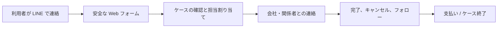

<!-- DRAFT: pending native review before publication. -->
# Taishoku Reset — 本番稼働中の退職代行 SaaS

> **これはケーススタディであり、コードの公開ではありません。** このリポジトリには、ソースコード、顧客データ、プロンプト、データベーススキーマ、価格ロジック、内部指標は含まれていません。コードの概要説明は NDA の範囲で可能です。

[English](README.md) · [Español](README.es.md) · [Português](README.pt.md) · [アーキテクチャ](architecture.md) · [出典](SOURCES.md)

---

## 概要

| | |
|---|---|
| **プロダクト** | 日本市場向けの退職代行 SaaS |
| **チャネル** | LINE + 安全な Web フォーム + 人による運用 |
| **状態** | 2026-11-08 から本番稼働 |
| **役割** | 共同創業者 / Tech Lead |
| **技術範囲** | アーキテクチャ、実装、デプロイ、連携、信頼性 |
| **公開リンク** | [サイト](https://taishokureset.com) · [Instagram](https://www.instagram.com/taishokureset/) · [特商法](https://taishokureset.com/tokushoho) |

---

## 課題

日本で仕事を辞めることは、難しいプロセスになることがあります。会社との連絡、書類、電話対応、プライバシーの保護などです。退職代行サービスは、そのプロセスを本人に代わって進めます。

センシティブな会話を扱うため、エラーは許されません。利用者は何が起きるかを理解できる必要があり、会社は信頼できるケース管理を必要とし、システムは個人データを慎重に扱う必要があります。

## プロダクト

Taishoku Reset は、そのサービスのための SaaS です。公開されているプロダクトは次を組み合わせています。

- LINE からの最初の連絡
- ケースに必要な情報のための安全な Web フォーム
- ケース対応と電話のための人による運用フロー
- AI による翻訳・音声の支援
- サービス情報と法的表示を含む公開サイト
- 公開 Instagram チャネル

商業条件、法的代理、顧客記録は会社が所有しており、このケーススタディには含まれません。

## 公開フロー

公開サイトで説明されているフローの概要です。

この図では、内部状態、エンドポイント、メッセージテンプレート、価格ルール、オペレーターの操作を意図的に省略しています。

## アーキテクチャ

本番システムは Cloudflare 上の Next.js アプリケーションです。アプリケーションデータに Cloudflare D1/KV、認証、AI サービス（Vertex AI）、Telnyx 電話連携の Cloud Run 音声エージェントを使っています。

ボックス図と信頼境界は [architecture.md](architecture.md) を参照してください。公開 HTTP ヘッダーで Next.js と Cloudflare を確認できます。それ以外のスタックは、このケーススタディで許可された範囲で説明しています。

## エンジニアリング上の課題

実装手順ではなく、ソリューションレベルの課題です。

### 1. LINE webhook の信頼性

LINE は最初の接点なので、イベントの欠落や重複は利用者に見えます。冪等性、リトライ、順序、ケース状態との照合が必要です。利用者に同じ情報を何度も入力させてはいけません。

### 2. 安全な単回使用フォーム

フォームのリンクはセンシティブです。個人情報を含む可能性があり、ケースへの恒久的な鍵になってはいけません。短寿命の単回リンク、サーバー側検証、データ最小化を使っています。トークンの形式と保存スキーマは公開しません。

### 3. 音声エージェントの 発話のターン制御

電話はチャットより許容度が低いです。割り込み、無音、ASR の誤り、背景ノイズ、人への引き継ぎを扱う必要があります。エージェントは 人による監督下の支援チャネルであり、オペレーターの完全な代替ではありません。

### 4. D1 マイグレーションと運用安全

Cloudflare D1 をアプリケーション DB として使っています。変更にはバージョン付きマイグレーション、バックアップ/リストア、ロールバック の経路が必要です。マイグレーションファイル、テーブル名、backup 手順は含めていません。

### 5. 日本語 UX と敬語

顧客向けの日本語には、一貫した丁寧なレジスターが必要です。レビュー済みのコピーを使い、日本語を「自動翻訳の出力」ではなく「人によるレビューが必要なプロダクト面」として扱っています。このケーススタディは、著者の日本語レベルを主張するものではありません。

### 6. 同意、プライバシー、アクセス制御

個人情報と雇用情報を扱います。収集する情報を最小化し、公開コンテンツとケースデータを分離し、オペレーターのアクセスを制限し、認証情報をリポジトリの外に置いています。顧客データ、保存期間、インシデント記録は公開しません。

## 私が担当したこと

- 技術アーキテクチャとプロダクトの提供
- Web/Cloudflare スタックの実装とデプロイ
- 音声・翻訳サービスと電話連携の統合
- LINE、フォーム、マイグレーション、運用引き継ぎの信頼性
- エンジニアリング文書、レビュー、リリースチェック

## 私が担当していないこと

- 会社の法的代理と法的表示
- 商業価格と顧客契約
- 日々のケース対応と顧客関係
- 公開されている特商法ページの内容（リンクのみで、コピーはしません）

## 意図的に含めていないもの

ソースコード、D1 スキーマ、プロンプト、価格ロジック、オペレーターパネル、インシデント資料、顧客データ、会話キャプチャ、コンバージョン指標、内部エンドポイント、分析 ID はありません。

## 公開されている証拠

- [Taishoku Reset](https://taishokureset.com) — 公開サイト。
- [Instagram @taishokureset](https://www.instagram.com/taishokureset/) — 公開チャネル。特定の reel は埋め込みません。
- [特商法ページ](https://taishokureset.com/tokushoho) — 公開の法的表示。リンクのみで、転載しません。販売者の公開連絡先が含まれますが、このリポジトリにはコピーしません。
- [出典](SOURCES.md) — 主張ごとの出典と、公開情報で検証できる範囲。

## 公開の許可

会社（共同創業者）の許可に基づき、2026-11-18 に公開します。許可される範囲は、プロダクト名、著者の役割、公開フロー、ボックス単位のアーキテクチャ、公開リンクです。コード、認証情報、プロンプト、スキーマ、オペレーターパネル、価格ロジック、顧客データ、内部指標は除外します。
