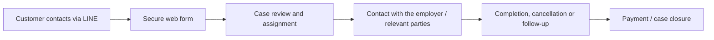

# Taishoku Reset — a production exit-agency SaaS in Japan

> **Case study, not a code release.** This repository contains no source code,
> no customer data, no prompts, no database schema, no pricing logic and no
> internal metrics. A code walkthrough is available under NDA.

[Español](README.es.md) · [Português](README.pt.md) · [日本語](README.ja.md) · [Architecture](architecture.md) · [Sources](SOURCES.md)

---

## At a glance

| | |
|---|---|
| **Product** | 退職代行 (exit-agency) SaaS for the Japanese market |
| **Channel** | LINE intake + secure web forms + human operations |
| **Status** | In production since 2026-11-08 |
| **My role** | Co-Founder & Tech Lead |
| **Technical scope** | Architecture, implementation, deployment, integrations, reliability |
| **Public links** | [Website](https://taishokureset.com) · [Instagram](https://www.instagram.com/taishokureset/) · [特商法](https://taishokureset.com/tokushoho) |

---

## The problem

People who want to leave a job in Japan can face a difficult process: contacting
the employer, handling paperwork, managing calls and protecting their privacy.
An exit-agency service handles that process on the customer's behalf.

The product must support a sensitive conversation with a low tolerance for
errors: the customer needs to understand what will happen, the company needs a
reliable case workflow, and the engineering system must handle personal data with
care.

## The product

Taishoku Reset is a SaaS for that service. The public product combines:

- a LINE-based first contact;
- secure web forms for the information the case needs;
- a human operations workflow for case handling and calls;
- AI-assisted translation/voice capabilities;
- a public website with service information and legal disclosures;
- a public Instagram channel for communication.

The exact commercial terms, legal representation and customer records are owned
by the company and are not part of this case study.

## Public flow

This is the flow described on the public website, at a high level:

The diagram intentionally omits internal states, endpoints, message templates,
pricing rules and operator actions.

## Architecture

The production system is a Next.js application running on Cloudflare, with
Cloudflare D1/KV for application data, authentication, AI services (Vertex AI)
and a Cloud Run voice agent integrated with Telnyx telephony.

See [architecture.md](architecture.md) for the box-level diagram and trust
boundaries. The public HTTP headers confirm Next.js and Cloudflare; the rest of
the stack is described at the level authorized for this case study.

## Engineering challenges

These are solution-level problems, not implementation recipes.

### 1. LINE webhook reliability

LINE is the first contact channel, so missed or duplicated events are visible to
customers. The design needs idempotency, retry handling, ordering discipline and
a way to reconcile an event with the case state without asking the customer to
repeat information.

### 2. Secure, single-use forms

The form link is a sensitive object: it can contain personal information and it
must not become a permanent key to a case. The design uses short-lived,
single-use links, server-side validation and data minimization. The exact token
format and storage schema are not published.

### 3. Voice-agent turn-taking

A phone conversation is less forgiving than a chat. The voice agent must handle
interruptions, silence, ASR errors, background noise and handoff to a human. The
design treats the agent as an assisted channel, not as an unsupervised
replacement for the operator.

### 4. D1 migrations and operational safety

Cloudflare D1 is the application database. Changes need versioned migrations,
backup/restore discipline and a rollback path. The migration files, table names
and backup procedure are intentionally not included here.

### 5. Japanese UX and keigo

Customer-facing Japanese needs a consistent, polite register. The product uses
reviewed copy and treats Japanese text as a product surface that needs human
review, not as an automatic translation output. This case study does not claim a
Japanese-language level for its author.

### 6. Consent, privacy and access control

The service handles personal and employment information. The design minimizes
what is collected, separates public content from case data, restricts operator
access and keeps credentials out of the repository. Customer data, retention
periods and incident records are not published.

## What I owned

- Technical architecture and the delivery of the product.
- Implementation and deployment of the web/Cloudflare stack.
- Integration of AI translation/voice services and telephony.
- Reliability work around LINE intake, forms, migrations and operational
  handoffs.
- Engineering documentation, reviews and release checks.

## What I did not own

- The company's legal representation and legal disclosures.
- Commercial pricing and customer contracts.
- Day-to-day casework and customer relationships.
- The contents of the public 特商法 page; it is linked, not copied.

## What is intentionally absent

No source code, no D1 schema, no prompts, no pricing logic, no operator panel, no
incident documents, no customer data, no conversation captures, no conversion
metrics, no internal endpoints and no analytics IDs.

## Public evidence

- [Taishoku Reset](https://taishokureset.com) — public product site.
- [Instagram @taishokureset](https://www.instagram.com/taishokureset/) — public
  channel; no specific reel is embedded.
- [特商法 page](https://taishokureset.com/tokushoho) — public legal disclosure;
  linked, not reproduced. It contains the seller's public contact details, which
  are deliberately not copied into this repository.
- [Sources](SOURCES.md) — claim-by-claim provenance, including the limits of
  public verification.

## Authorization

Published with authorization from the company (co-founder), 2026-11-18. The
authorized scope is the product name, the author's role, the public flow, the
box-level architecture and the public links. Code, credentials, prompts, schema,
operator panel, pricing logic, customer data and internal metrics are excluded.
