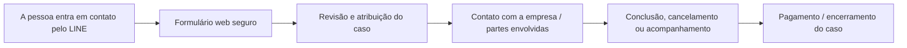

# Taishoku Reset — um SaaS de 退職代行 em produção

> **Estudo de caso, não uma release de código.** Este repositório não contém
> código, dados de clientes, prompts, schema de banco, lógica de preços nem
> métricas internas. O walkthrough de código está disponível sob NDA.

[English](README.md) · [Español](README.es.md) · [日本語](README.ja.md) · [Arquitetura](architecture.md) · [Fontes](SOURCES.md)

---

## Visão geral

| | |
|---|---|
| **Produto** | SaaS de 退職代行 (serviço de saída profissional) para o mercado japonês |
| **Canal** | LINE + formulários web seguros + operação humana |
| **Status** | Em produção desde 2026-11-08 |
| **Papel** | Cofundador e Tech Lead |
| **Escopo técnico** | Arquitetura, implementação, deploy, integrações e confiabilidade |
| **Links públicos** | [Site](https://taishokureset.com) · [Instagram](https://www.instagram.com/taishokureset/) · [特商法](https://taishokureset.com/tokushoho) |

---

## O problema

Sair de um emprego no Japão pode ser um processo difícil: falar com a empresa, cuidar da papelada, atender ligações e proteger a privacidade. Um serviço de 退職代行 faz esse processo em nome da pessoa.

O produto precisa sustentar uma conversa sensível com pouca margem para erro: a pessoa precisa entender o que vai acontecer, a empresa precisa de um fluxo de casos confiável e o sistema precisa tratar dados pessoais com cuidado.

## O produto

Taishoku Reset é um SaaS para esse serviço. O produto público combina:

- primeiro contato por LINE;
- formulários web seguros para as informações do caso;
- um fluxo humano de gestão de casos e ligações;
- recursos de voz/tradução assistidos por IA;
- um site público com informações e avisos legais;
- um canal público de Instagram.

As condições comerciais, a representação legal e os registros de clientes pertencem à empresa e não fazem parte deste estudo.

## Fluxo público

O fluxo descrito no site público, em alto nível:

O diagrama omite de propósito estados internos, endpoints, modelos de mensagem, regras de preços e ações do operador.

## Arquitetura

O sistema de produção é uma aplicação Next.js na Cloudflare, com Cloudflare D1/KV para dados da aplicação, autenticação, serviços de IA (Vertex AI) e um agente de voz no Cloud Run integrado à telefonia Telnyx.

Ver [architecture.md](architecture.md) para o diagrama em caixas e os limites de confiança. Os headers HTTP públicos confirmam Next.js e Cloudflare; o restante do stack é descrito no nível autorizado para este estudo.

## Desafios de engenharia

São problemas em nível de solução, não receitas de implementação.

### 1. Confiabilidade do webhook do LINE

O LINE é o primeiro canal de contato; um evento perdido ou duplicado é percebido pela pessoa. O design precisa de idempotência, retentativas, ordenação e reconciliação com o estado do caso sem pedir que a pessoa repita informações.

### 2. Formulários seguros de uso único

O link do formulário é um objeto sensível: pode conter informação pessoal e não deve virar uma chave permanente para o caso. O design usa links de vida curta, uso único, validação no servidor e minimização de dados. O formato exato do token e o schema de armazenamento não são publicados.

### 3. Turn-taking do agente de voz

Uma ligação é menos tolerante que um chat. O agente precisa lidar com interrupções, silêncio, erros de ASR, ruído de fundo e transferência para uma pessoa. O design trata o agente como canal assistido, não como substituto sem supervisão do operador.

### 4. Migrações D1 e segurança operacional

Cloudflare D1 é o banco da aplicação. Mudanças precisam de migrações versionadas, disciplina de backup/restore e caminho de rollback. Os arquivos de migração, nomes de tabelas e procedimento de backup não são incluídos.

### 5. UX japonesa e keigo

O japonês voltado ao cliente precisa de um registro consistente e educado. O produto usa textos revisados e trata o japonês como uma superfície de produto que exige revisão humana, não como saída automática. Este estudo não reivindica um nível de japonês para o autor.

### 6. Consentimento, privacidade e controle de acesso

O serviço trata informações pessoais e trabalhistas. O design minimiza o que coleta, separa conteúdo público de dados de caso, restringe o acesso de operadores e mantém credenciais fora do repositório. Dados de clientes, prazos de retenção e registros de incidentes não são publicados.

## O que assumi

- A arquitetura técnica e a entrega do produto.
- A implementação e o deploy do stack web/Cloudflare.
- A integração de serviços de voz/tradução e telefonia.
- O trabalho de confiabilidade em LINE, formulários, migrações e passagens operacionais.
- A documentação de engenharia, revisões e checks de release.

## O que não assumi

- A representação legal e os avisos legais da empresa.
- Os preços comerciais e os contratos com clientes.
- O trabalho diário de casos e a relação com clientes.
- O conteúdo da página pública de 特商法; ela é linkada, não copiada.

## O que está ausente de propósito

Nada de código, schema D1, prompts, lógica de preços, painel de operadores, documentos de incidentes, dados de clientes, capturas de conversas, métricas de conversão, endpoints internos ou IDs de analytics.

## Evidência pública

- [Taishoku Reset](https://taishokureset.com) — site público.
- [Instagram @taishokureset](https://www.instagram.com/taishokureset/) — canal público; nenhum reel específico é embutido.
- [Página de 特商法](https://taishokureset.com/tokushoho) — aviso legal público; linkado, não reproduzido. Contém dados de contato públicos do vendedor, que não são copiados neste repositório.
- [Fontes](SOURCES.md) — procedência afirmação por afirmação e limites de verificação pública.

## Autorização

Publicado com autorização da empresa (cofundador), 2026-11-18. O escopo autorizado é o nome do produto, o papel do autor, o fluxo público, a arquitetura em caixas e os links públicos. Ficam excluídos código, credenciais, prompts, schema, painel de operadores, lógica de preços, dados de clientes e métricas internas.
