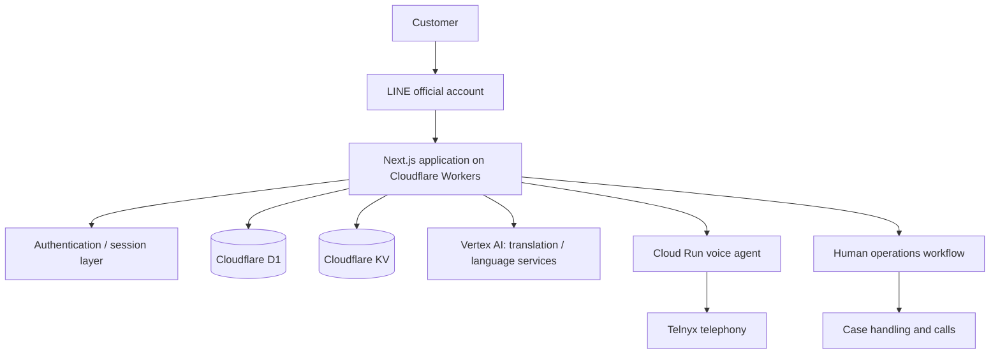

# Architecture (box level)

This is a deliberately coarse view. It is useful for discussing trade-offs and
ownership without exposing internal endpoints, schema, prompts or operator
screens.

## Trust boundaries

- **Public edge:** website, public legal pages, Instagram and LINE entry point.
- **Authenticated application:** forms, case state and operator actions.
- **Data stores:** D1/KV hold application data; credentials are managed outside
  the repository.
- **AI services:** text/voice processing is an external dependency with its own
  data-handling terms; the product treats it as a processor, not as a source of
  truth.
- **Telephony:** Cloud Run + Telnyx handle the voice channel; the operator remains
  responsible for the case.

## What is not shown

- Internal API routes and request/response shapes.
- D1 table definitions, migrations and indexes.
- Prompt templates and model parameters.
- Pricing, refund and cancellation rules.
- Operator dashboard and customer conversation views.
- Analytics IDs, conversion metrics and incident procedures.

## Design principles

1. **The case state is the source of truth.** Public pages and AI outputs do not
   mutate a case directly.
2. **Sensitive links are short-lived and single-use.** Access is validated on the
   server, not only in the browser.
3. **AI assists, humans decide.** Voice/translation output is a support layer;
   the operator owns the case.
4. **Migrations are versioned and reversible.** A schema change has a rollback
   path and a backup.
5. **Japanese copy is reviewed.** Customer-facing text is a product surface, not
   an unreviewed model output.
6. **Credentials never live in the repository.** Secrets are managed outside the
   codebase and excluded from public artifacts.

## Verification limits

The public website and HTTP headers confirm the Next.js/Cloudflare surface. The
private stack details are described from the author's knowledge of the production
system; they are not independently verifiable from public sources. See
[SOURCES.md](SOURCES.md).
